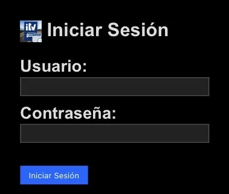
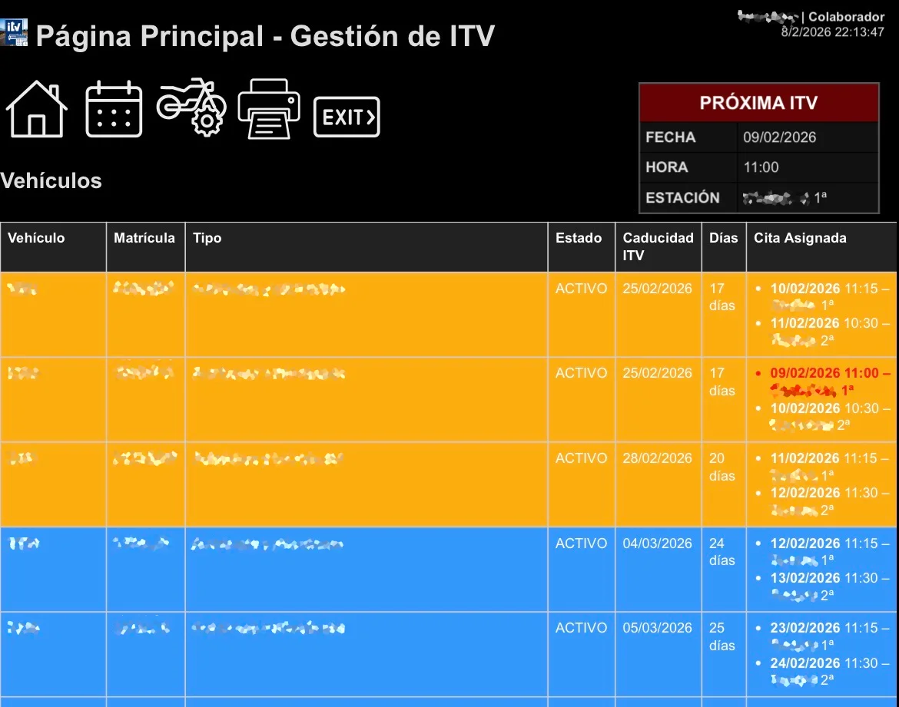

# ITVControl


Este proyecto permite gestionar una o varias flotas de vehículos, sus citas de ITV, las Estaciones de ITV y los usuarios que pueden acceder al sistema.

## Novedades de la v8

- **Toda la aplicación en un único `index.php`.** Ya no hay 24 archivos PHP sueltos.
- **Los archivos de datos no se publican en GitHub.** se crean automáticamente con datos de muestra la primera vez que se ejecuta la aplicación.
- **`sync_offline.php` se mantiene aparte** porque es el endpoint que consume la aplicación HTA de sincronización offline.
- Las rutas antiguas (`citas.php`, `usuarios.php`, `login.php`...) siguen funcionando: el `.htaccess` las reescribe a `index.php?p=...`.

## Instrucciones de instalación

1. Descarga o clona el repositorio.
2. Sube los archivos a un servidor con **PHP 7.4+**. No requiere base de datos.
3. Coloca todos los archivos en una carpeta, por ejemplo `/var/www/html/itv/`.
4. Da permisos de escritura a la carpeta: la aplicación necesita crear los `.json` de datos y los logs.
   ```bash
   sudo chown -R www-data:www-data /var/www/html/itv
   ```
5. Accede a `'ip-host'/itv/index.php` en tu navegador.
6. Inicia sesión con las credenciales predeterminadas:
   - Usuario: `admin` — Contraseña: `admin`
   - Usuario: `usuario` — Contraseña: `usuario`

En la primera visita se crean automáticamente los archivos de datos con contenido de muestra. **Cambia las contraseñas por defecto** en cuanto entres.

## Estructura del repositorio

```
index.php           Toda la aplicación (router + vistas + lógica)
sync_offline.php    Endpoint JSON para la app HTA (se mantiene aparte)
.htaccess           Rewrite de rutas antiguas y bloqueo de archivos sensibles
manifest.json       Manifest PWA
style.css           Estilos
version.xk          Versión y autor (lo consulta el actualizador)
images/             Iconos e imágenes
```

Archivos que **no** están en el repositorio y se generan solos:

```
*.json y *.log
```

## Rutas

| Antes | Ahora |
|---|---|
| `login.php` | `index.php?p=login` |
| `citas.php` | `index.php?p=citas` |
| `usuarios.php` | `index.php?p=usuarios` |
| `vehiculos.php` | `index.php?p=vehiculos` |
| `sync_offline.php` | `sync_offline.php` (sin cambios, para la HTA) |

El `.htaccess` mantiene las rutas antiguas operativas. Si tu servidor no permite `mod_rewrite` o `AllowOverride`, la aplicación sigue funcionando igual entrando por `index.php`, porque todos los enlaces internos ya apuntan a la ruta nueva.

## Credenciales por defecto

- usuario: `admin` contraseña: `admin` Nivel: SuperAdministrador (Control total)
- usuario: `usuario` contraseña: `usuario` Nivel: Usuario (Consultar e imprimir)

## Tipos de usuario

- Usuario - Puede consultar e imprimir.
- Colaborador - Todo lo anterior + añadir citas, vehículos y modificar estados/caducidades.
- Administrador - Todo lo anterior + gestionar estaciones, ver IPs bloqueadas, añadir/modificar/desbloquear/eliminar usuarios.
- SuperAdministrador - Todo lo anterior + crear/editar/eliminar claves app cliente offline + editar id, matricula y flota vehiculo + desbloquear IPs bloqueadas.

El SuperAdministrador es el único que puede interactuar con todas las flotas. Los demás usuarios, incluidos los Administradores, únicamente podrán interactuar con su flota asignada, sin poder interferir en las demás.

## SEGURIDAD

- Se recomienda editar/eliminar el usuario `admin`. Si decide eliminarlo, antes cree otro `SuperAdministrador` para poder seguir gestionando los usuarios del sistema, ya que es el único que tiene este permiso.
- Se ha añadido una capa de seguridad para evitar la exposición de los archivos con datos sensibles. Si es necesario, editar `apache2.conf` -> `sudo nano /etc/apache2/apache2.conf` editando en el bloque `<Directory /var/www/>` la línea `AllowOverride None` por `AllowOverride All`, por último reinicie Apache2 `sudo systemctl restart apache2`. Aquellas IP que intenten acceder a contenidos no autorizados serán bloqueadas, pudiendo únicamente Administradores y SuperAdministradores acceder a la pestaña para ver y desbloquear dichas IP.
- Se ha añadido una capa de seguridad que limita a 3 intentos fallidos de login. Se guarda un log con los intentos fallidos y solo el SuperAdministrador podrá desbloquear dichos usuarios bloqueados, ya que es el único que puede acceder a la gestión de usuarios.
- Los archivos `.json` de datos y los `.log` están bloqueados por `.htaccess` para acceso HTTP directo.
- **No subas nunca `usuarios.json` al repositorio.** Ya está incluido en `.gitignore`.




## Actualizar

- Cuando exista una versión más reciente disponible en el canal oficial de GitHub, se mostrará un aviso en la página principal. Además del mensaje **“Nueva versión disponible”**, también se indicará la versión actualmente instalada y la nueva versión disponible.
- Si el usuario tiene el rol de **Administrador** o **Superadministrador**, se mostrará un botón adicional que permitirá realizar la actualización automática a la nueva versión.
- El actualizador descarga los archivos desde la rama `main`, **excluye** los `.json` y los `.log`, y actualiza `index.php` en último lugar mediante escritura atómica: si la descarga se corta, la aplicación sigue funcionando.
- Recuerde asegurarse de que los archivos cuenten con los permisos de escritura necesarios para que la actualización pueda completarse correctamente.

## Cómo contribuir

- Reporta errores en la sección Issues.
- Sugiere mejoras.
- Prueba la aplicación y envía feedback.
